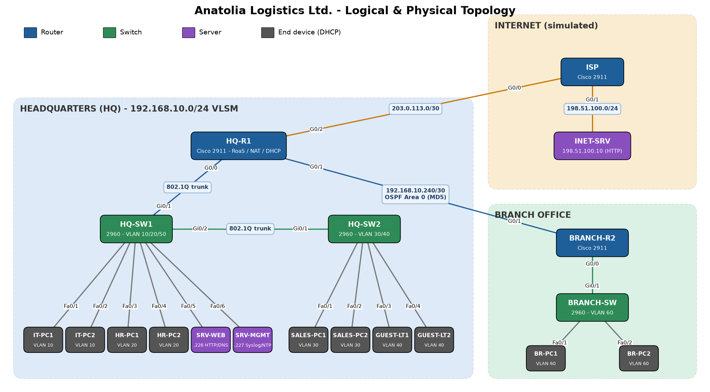
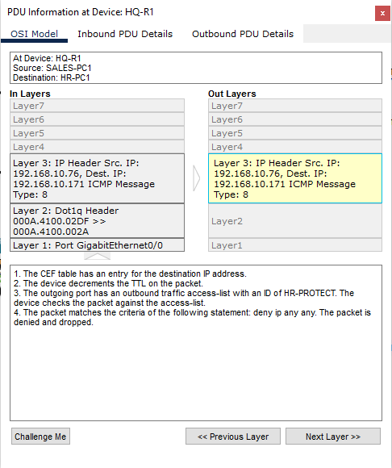
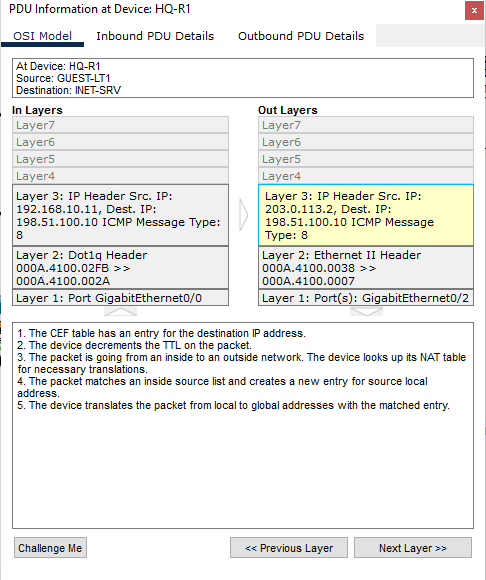

# Anatolia Logistics – Secure Multi-Site Enterprise Network

Design, VLSM subnetting, configuration, security hardening and traffic analysis of a two-site
enterprise network in **Cisco Packet Tracer 9.0**.

*Piri Reis University · Management Information Systems · YBS417 Network Management and Security*

> 🇹🇷 Hayali bir lojistik şirketinin (merkez + şube + internet) ağı: VLAN'lar, VLSM, DHCP, OSPF, NAT,
> ACL, SSH, port security, DHCP snooping ve Packet Tracer üzerinde gerçek testler.

---

## What is inside

| File / folder | Content |
|---|---|
| [`Anatolia_Logistics.pkt`](Anatolia_Logistics.pkt) | Ready-to-open Packet Tracer 9.0 file – all 19 devices cabled and configured |
| [`configs/`](configs) | IOS configuration scripts for every router and switch (paste into the CLI) |
| [`Project - Anatolia Logistics.docx`](Project%20-%20Anatolia%20Logistics.docx) | Full project report: proposal, VLSM calculations, configurations, security, tests, 22 screenshots |
| [`Anatolia Logistics – Secure Multi-Site Network.pdf`](Anatolia%20Logistics%20%E2%80%93%20Secure%20Multi-Site%20Network.pdf) / [`.pptx`](Anatolia%20Logistics%20%E2%80%93%20Secure%20Multi-Site%20Network.pptx) | 14-slide presentation |
| [`screenshots/`](screenshots) | Raw Packet Tracer captures; `screenshots/final/` = the 22 figures used in the report |
| [`Proposal_Calisma_Notu.pdf`](Proposal_Calisma_Notu.pdf) | Proposal study sheet (Turkish/English) |
| [`KURULUM_REHBERI.md`](KURULUM_REHBERI.md) | Step-by-step build and test guide (Turkish) |

## Network design

- **Headquarters** with five VLANs, **Branch Office**, and a simulated **ISP / Internet server**
- 3 × Cisco 2911 routers · 3 × Cisco 2960 switches · 3 servers · 10 end devices

### VLSM plan – one /24 for seven segments

| Segment | VLAN | Hosts | Network | Gateway |
|---|---|---|---|---|
| Guest | 40 | 50 | 192.168.10.0/26 | .1 |
| Sales | 30 | 40 | 192.168.10.64/26 | .65 |
| IT / Management | 10 | 25 | 192.168.10.128/27 | .129 |
| HR | 20 | 20 | 192.168.10.160/27 | .161 |
| Branch LAN | 60 | 18 | 192.168.10.192/27 | .193 |
| Servers | 50 | 8 | 192.168.10.224/28 | .225 |
| HQ–Branch WAN | – | 2 | 192.168.10.240/30 | .241 / .242 |

244 of 256 addresses allocated; `.244/30` and `.248/29` kept for growth.

### Services

- Router-on-a-stick inter-VLAN routing (802.1Q), native VLAN 999
- DHCP pools on the routers, internal DNS + web server (`intranet.anatolia.local`)
- OSPFv2 area 0 between HQ and Branch with a redistributed default route
- PAT (NAT overload) to the Internet through `203.0.113.2`
- Network management server: Syslog, NTP, TFTP configuration backups

### Security controls

| Layer | Control |
|---|---|
| Device | `enable secret`, password encryption, `login block-for`, MOTD banner |
| Management | SSH v2 only, local users, VTY `access-class` limited to the IT VLAN |
| Switch port | Port security (1 sticky MAC, shutdown), DHCP snooping, PortFast + BPDU Guard |
| VLAN | Non-default native VLAN, DTP disabled, unused ports in a shut-down black-hole VLAN |
| Routing | OSPF MD5 authentication, passive LAN interfaces |
| Traffic | `GUEST-IN` (guests → Internet only) and `HR-PROTECT` (only IT and servers reach HR) extended ACLs |

## Verified in Packet Tracer

| Test | Result |
|---|---|
| IT → HR ping | ✅ allowed |
| Sales → HR ping | ❌ `Destination host unreachable` (HR-PROTECT) |
| Guest → Sales ping | ❌ blocked (GUEST-IN) |
| Guest → `www.internet.com` | ✅ page loads through PAT |
| Guest → `intranet.anatolia.local` | ❌ `Request Timeout` |
| SSH from IT / from Sales | ✅ login / ❌ `Connection refused` |
| Spoofed MAC on an access port | 🔒 port err-disabled, `PSECURE_VIOLATION` logged |
| Rogue DHCP server in the HR VLAN | 🔒 client still gets the legitimate lease (DHCP snooping) |
| OSPF hello | 🔒 Auth Type 2 (MD5) |

| ACL drop (Simulation mode) | NAT translation (Simulation mode) |
|---|---|
|  |  |

## How to open

1. Install **Cisco Packet Tracer 9.0** (or newer).
2. Open `Anatolia_Logistics.pkt`. Links turn green after ~30–60 s (STP); *Fast Forward Time* speeds this up.
3. Lab credentials – console `C0ns0leP@ss`, enable `Ent3rpr1se!`, SSH `netadmin / Adm1nP@ss!`.

> These passwords exist only in this lab simulation.
